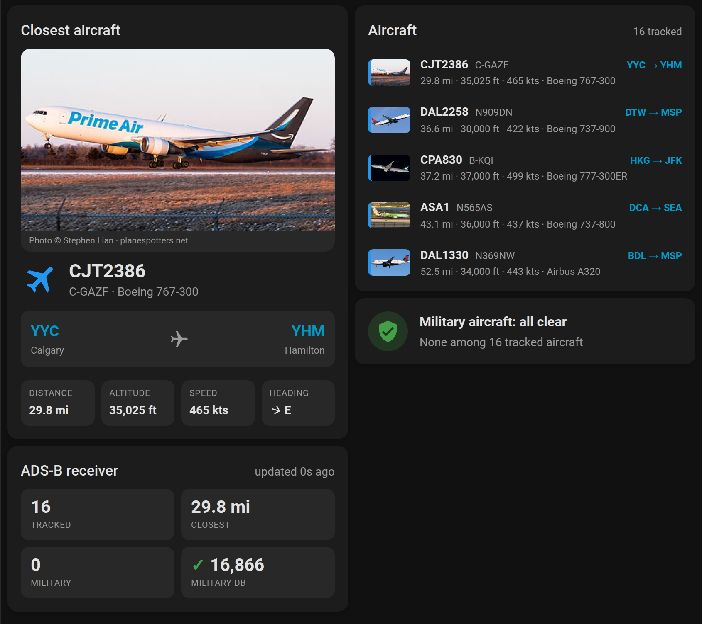
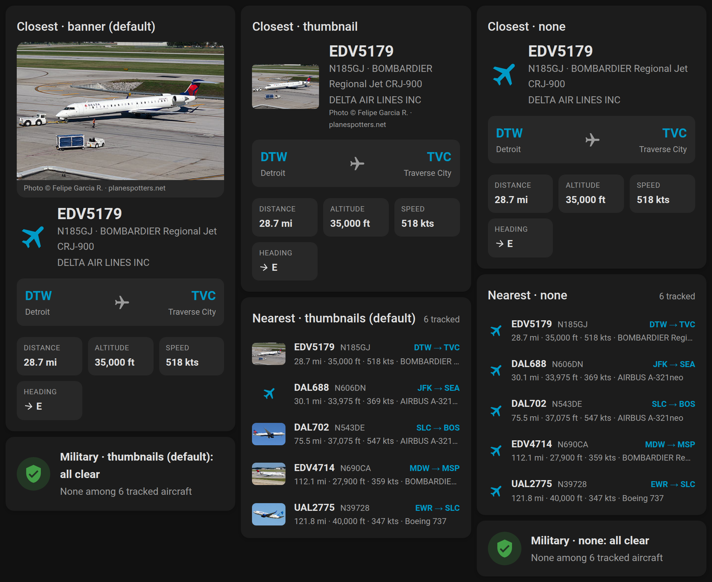
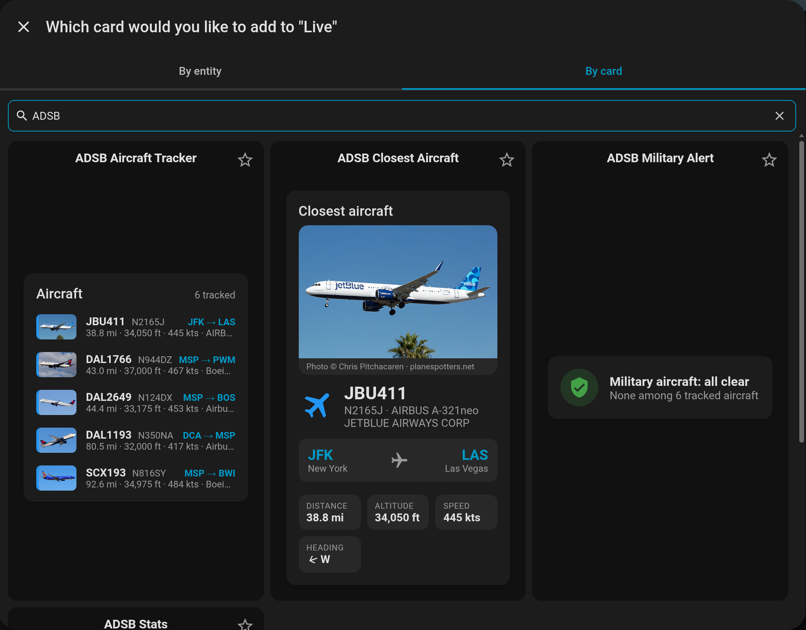
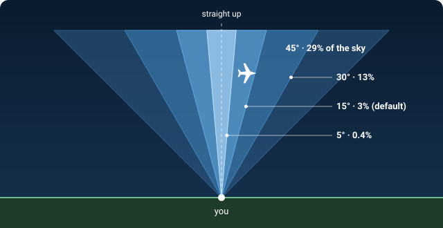

# ADSB Aircraft Tracker for Home Assistant

[![GitHub Release][releases-shield]][releases]
[![GitHub Activity][commits-shield]][commits]
[![License][license-shield]](LICENSE)

A comprehensive Home Assistant integration for tracking aircraft using ADSB data from dump1090/tar1090 feeders, with built-in dashboard cards, voice queries and military aircraft alerts.



## What's New

**1.9.0 — Choose your units.** Aeronautical, imperial or metric, in
**CONFIGURE → Units**; see [Units](#units). Thanks to
[@medivb](https://github.com/medivb) for the request.

**1.8.3 — Plainer cards.** The dashboard cards no longer color aircraft by
altitude: the colored strip on small photos is gone and airplane icons use
your theme's primary color. Rows without a photo now line up with the rest.

**1.8.2 — Overhead alerts, and your own alert wording.** A new alert for
aircraft almost straight above you at any altitude, with an adjustable angle
(default 15° from straight up); off by default, see [Overhead](#overhead).
And every alert's title and message can now be reworded in **CONFIGURE →
Alert Wording**, with tokens like `{name}` and `{altitude}`; see
[Your own wording](#your-own-wording).

**1.8.1 — Older dump1090 feeders.** Altitude, speed and vertical rate now
show for feeders that use the legacy `aircraft.json` field names (`altitude`,
`speed`, `vert_rate`), including the dump1090 bundled in the Flightradar24
feeder image. They showed 0 before.

**1.8.0 — Alerts to several devices, and alerts that open the aircraft.**
"Devices for alerts" is now a multi-select that also lists notify groups, and
the external URL takes `{hex}`, `{flight}` or `{registration}` so tapping an
alert opens that aircraft on tar1090, adsb-3d or a public tracker.

**1.7.0 — Aircraft photos.** The cards now show a picture of the airframe
from [planespotters.net](https://www.planespotters.net): a photo banner on
the closest-aircraft card, a thumbnail per row on the nearest-aircraft and
military cards, and the picture in military, low-overhead and emergency
notifications. It's on by default with nothing to configure; each card has
a **Photo** style in its editor. See [Photos on the cards](#photos-on-the-cards).



Every release lists its changes in [CHANGELOG.md](CHANGELOG.md), newest first.
The same notes appear on the [GitHub release][releases] and in HACS when it
offers you the update, so you can see what changed before you install it.

## Features

📊 **Dashboard Cards** (built in, nothing to install)
- Four ready-made cards in the dashboard **Add card** picker (live preview, one click): nearest aircraft, closest aircraft detail, military alert, receiver stats
- Routes, climb/descent and heading at a glance
- A photo of the airframe from [planespotters.net](https://www.planespotters.net) on the closest-aircraft card, thumbnails in the list, and the picture in notifications (nearest and military aircraft, cached a day, credited)
- Find your tracker's entities automatically, with a visual editor, and work with multiple feeders

🛩️ **Aircraft Tracking**
- Real-time aircraft monitoring within configurable distance
- Detailed aircraft information (tail number, flight, altitude, speed, type)
- Top 5 closest aircraft with comprehensive details
- Aircraft type database with 85,000+ aircraft models
- Distance and bearing measured from your Home Assistant home location
- Your choice of units: aeronautical (nm, ft, kts), imperial (mi, ft, mph) or metric (km, m, km/h)
- Registration and aircraft type filled in from the tar1090-db database when the feeder doesn't send them (PiAware/dump1090-fa, bridges)
- Flight route (origin/destination) for every aircraft with a callsign, as sensor attributes
- Works with any readsb-style `aircraft.json` source (tar1090, readsb, dump1090-fa/SkyAware, or bridges from other receivers); the data path is auto-detected

📱 **Smart Notifications**
- Mobile app notifications for specific aircraft types, to one phone, several, or a notify group
- Low altitude aircraft alerts
- Overhead alerts when an aircraft is almost straight above you, at any altitude (off by default)
- Your own wording for every alert title and message
- Emergency squawk code notifications (7700/7600/7500)
- Customizable external ADSB URL links

🗣️ **Voice / Assist Support**
- 7 voice intents with 77 sentence variations
- TTS-friendly output: colloquial model names, airline code expansion, no mispronounced hyphens
- Flight route lookup (origin/destination) via [adsb.im](https://adsb.im)
- Filter by type: helicopters, jets, turboprops, military
- Works with Home Assistant Assist and voice pipelines
- Exposed as LLM tools for AI conversation agents (Home Assistant 2026.8+)

🔧 **Advanced Features**
- Runtime configuration changes (no restart required)
- Custom services for testing and manual control
- Developer tools for debugging detection logic
- Comprehensive error handling and logging

## Requirements

- **Home Assistant** 2023.7 or newer (service response support)
- **ADSB Feeder** (dump1090/tar1090) running on your network
- **Mobile App** (optional, for notifications)

## Installation

### Via HACS (Recommended)

1. Open HACS in Home Assistant
2. Click on "Integrations"
3. Click the three dots in the top right corner
4. Select "Custom repositories"
5. Add this repository URL: `https://github.com/hook-365/adsb-aircraft-tracker`
6. Select "Integration" as the category
7. Click "Add"
8. Find "ADSB Aircraft Tracker" in the integration list and install
9. Restart Home Assistant
10. Go to Settings → Devices & Services → Add Integration
11. Search for "ADSB Aircraft Tracker" and follow the setup

### Manual Installation

1. Download the latest release from [GitHub][releases]
2. Extract the files to your `custom_components/adsb_aircraft_tracker/` directory
3. Restart Home Assistant
4. Go to Settings → Devices & Services → Add Integration
5. Search for "ADSB Aircraft Tracker"

## Configuration

### Initial Setup

1. **ADSB Host**: IP address of your dump1090/tar1090 feeder (e.g., `192.168.1.100`)
2. **ADSB Port**: Port number (default: `8085`)
3. **Data Path** (optional): Leave blank to auto-detect. Setup tries `/data/aircraft.json` (tar1090/readsb), `/tar1090/data/aircraft.json`, `/skyaware/data/aircraft.json`, `/dump1090-fa/data/aircraft.json`, `/dump1090/data/aircraft.json`, `/aircraft.json`, then `/`, and keeps the first one that returns aircraft JSON. Set it explicitly for adapters that serve data somewhere else.
4. **Update Interval**: How often to fetch data (default: `10` seconds)
5. **Distance Limit**: Aircraft range in miles, or kilometers if Home Assistant is set to metric (`0` = unlimited)

Any source that returns readsb-style JSON (a top-level `"aircraft"` list with `hex`, `lat`/`lon`, `alt_baro`, `gs`, `track`, `flight`) works, including bridges from other services. Older dump1090 builds that use the legacy field names `altitude`, `speed` and `vert_rate` (such as the dump1090 bundled in the Flightradar24 feeder image) are read too. The content type doesn't matter; `text/plain` is accepted.

### Units

Go to **CONFIGURE → Units** to choose how distance, altitude and speed are shown:

| Setting | Distance | Altitude | Speed |
|---|---|---|---|
| Automatic (default) | miles or kilometers, following Home Assistant | feet | knots |
| Aeronautical | nautical miles | feet | knots |
| Imperial | miles | feet | miles per hour |
| Metric | kilometers | meters | kilometers per hour |

The choice applies to the dashboard cards, notifications, voice answers, and the range and alert thresholds in the options (they are shown and entered in your units).

The sensor attributes `distance_mi`, `altitude_ft` and `speed_kts` always stay in miles, feet and knots, so automations that compare them keep working whatever you pick. For text in your units, use `distance_display`, `altitude_display` and `speed_display`.

### Flightradar24 Receivers

A local Flightradar24 receiver doesn't serve `aircraft.json` itself. Brian O'Hern's [FR24 dump1090 Bridge](https://github.com/brian-r-ohern/fr24-dump1090-bridge) is a Home Assistant app that polls the receiver's local `/flights.js` feed and republishes it at `/data/aircraft.json`. Position, altitude, speed, heading, callsign and Mode-S hex are translated conservatively, and aircraft without a position stay in the feed (they count toward totals but not closest/nearest).

1. **Settings → Apps → Install app**, open the repository menu and add `https://github.com/brian-r-ohern/fr24-dump1090-bridge`
2. Install **FR24 dump1090 Bridge**, enter your receiver's host, port, username and password, and start it
3. Set up this integration with **ADSB Host** = the hostname on the bridge's **Info** page, **Port** = `8085`, and leave **Data Path** blank

### Advanced Options

After initial setup, click **CONFIGURE** on your integration to access advanced options:

- **Devices for alerts**: one or more notify services. Phones with the Home Assistant mobile app and any [notify groups](https://www.home-assistant.io/integrations/group/#notify-groups) you have defined are listed; every alert goes to all of them
- **External URL**: website an alert opens when tapped. Defaults to your feeder. Put `{hex}`, `{flight}` or `{registration}` in it to open that aircraft, e.g. `https://my-tar1090/?icao={hex}`
- **Overhead alerts** (default off), **Overhead angle** (default 15°) and **Overhead maximum altitude** (default no limit):: see [Overhead](#overhead)
- **Update Interval**: Adjust data refresh frequency
- **Distance Limit**: Set maximum tracking range
- **Aircraft photos** (default on): look up a photo of each nearby or military airframe on [planespotters.net](https://www.planespotters.net) for the cards and notifications. One request per newly seen airframe, nearest five plus military only, cached 24 hours either way; photographer credit and a link to the photo page are shown, as their API terms ask. The route lookup contact below is sent in the User-Agent here too.
- **Route lookup contact** (optional): email or URL sent to [adsb.im](https://adsb.im) in the User-Agent of flight-route lookups (`adsb-aircraft-tracker/<version> (+repo; contact)`). adsb.im is a one-person hobby service and asks callers to identify themselves; empty sends only the project URL.

## Dashboard Cards

The integration ships four dashboard cards. There's nothing to install: they load automatically with the integration. Edit a dashboard → **Add card** → **By card** tab → search **ADSB**. The picker previews each card with your live traffic, photos included; pick one and it's done.



| Card | Shows |
|------|-------|
| **ADSB Aircraft Tracker** (`custom:adsb-aircraft-tracker-card`) | The nearest 1–5 aircraft: callsign, tail, route, distance, altitude, speed, with a military flag |
| **ADSB Closest Aircraft** (`custom:adsb-closest-aircraft-card`) | The closest aircraft in detail: photo, type, operator, route with city names, distance, altitude with climb/descent, speed, heading, emergency squawks |
| **ADSB Military Alert** (`custom:adsb-military-card`) | A green "all clear", or a red alert listing each military aircraft detected |
| **ADSB Stats** (`custom:adsb-stats-card`) | Tracked aircraft, closest distance, military count and military-database health |

Every card finds your tracker's entities by itself, so they work whatever your entity IDs are. If you have more than one feeder, pick which tracker in the card editor. Tap any card or row for details.

```yaml
type: custom:adsb-aircraft-tracker-card   # or any of the card types above
title: Aircraft   # optional
count: 5          # optional, nearest-aircraft card only (1-5)
photos: thumbnail # optional, see below
device_id: ...    # optional; the editor fills this in when you pick a tracker
```

### Photos on the cards

With **Aircraft photos** on (the default, see Configuration), each card can
show the airframe's photo from [planespotters.net](https://www.planespotters.net).
Pick the style in the card editor or with `photos:`:

| Card | `photos` values | Default |
|------|-----------------|---------|
| ADSB Closest Aircraft | `banner` (large photo above the details, with credit), `thumbnail` (small photo next to the callsign), `none` | `banner` |
| ADSB Aircraft Tracker | `thumbnail` (small photo per row), `none` | `thumbnail` |
| ADSB Military Alert | `thumbnail` (small photo per row), `none` | `thumbnail` |

Aircraft without a photo (most GA traffic) fall back to the airplane icon,
so mixed lists stay aligned. Every photo credits the photographer and
links to its planespotters.net page.

To add one from the UI: edit a dashboard → **Add card** → **By card** →
search **ADSB** → pick a card. The preview already shows the photo, and the
**Photo** dropdown in the editor switches the style. In YAML, this is the whole "photo
dashboard" from the picture above (a closest-aircraft banner with the
nearest five under it):

```yaml
type: vertical-stack
cards:
  - type: custom:adsb-closest-aircraft-card
    photos: banner
  - type: custom:adsb-aircraft-tracker-card
    count: 5
    photos: thumbnail
```

Photos are also available to your own cards and automations as sensor
attributes (`photo_thumbnail`, `photo_large`, `photo_link`,
`photo_photographer`). A plain Markdown card, no extras needed:

```yaml
type: markdown
content: >-
  
  
  

  [Photo © {{ a.photo_photographer }} · planespotters.net]({{ a.photo_link }})
  No photo for {{ a.flight or a.registration or 'the closest aircraft' }}.
```

## Voice / Assist Support

Ask your Home Assistant voice assistant about aircraft overhead and get natural, TTS-friendly spoken responses.

### Setup

1. Go to **Developer Tools → Services**
2. Call `adsb_aircraft_tracker.install_sentences`
3. Restart Home Assistant

That's it — the custom sentences are installed and the intent handlers register automatically.

### Intents & Example Phrases

#### Identify Aircraft — `ADSBWhatPlane`
> "What plane is that?" · "What's flying overhead?" · "What's up there?" · "What kind of plane is that?" · "Identify that aircraft"

**Response:** *"That's United 1 2 3, a Boeing 738, flying from Chicago to Denver, about 4 miles away, climbing through 12,000 feet, heading southwest, cruising at 450 knots."*

#### Nearest Aircraft — `ADSBNearestAircraft`
> "What planes are nearby?" · "Any planes around?" · "What do you see flying?" · "What planes can you see?"

**Response:** *"I'm tracking 47 aircraft. The nearest are: United 1 2 3, 4 miles away, at 32,000 feet, heading southwest; Delta 4 5 6, 8 miles away, descending through 15,000 feet; and SkyWest 7 8 9, 12 miles away, at 24,000 feet."*

#### Military Status — `ADSBMilitaryStatus`
> "Any military planes nearby?" · "Are there any military aircraft?" · "Military aircraft status"

**Response:** *"I'm detecting 2 military aircraft. The closest is a Boeing K C 135 Stratotanker, 15 miles away, at 24,000 feet, heading northeast."*

#### Aircraft Count — `ADSBAircraftCount`
> "How many planes?" · "How many aircraft are you tracking?" · "How many planes are out there?"

**Response:** *"I'm currently tracking 47 aircraft. The closest is 4 miles away."*

#### Flight Route — `ADSBAircraftRoute`
> "Where is that plane going?" · "What's the flight route?" · "Where did that plane come from?"

**Response:** *"The closest aircraft, United 1 2 3, is flying from Chicago to Denver, about 4 miles away, at 32,000 feet."*

#### Filter by Type — `ADSBAircraftByType`
> "Any helicopter aircraft nearby?" · "Do you see any jet planes?" · "Any prop planes flying?"

*Sentences require an "aircraft"/"planes" anchor word after the type (e.g. "military planes", "jet aircraft") — bare wildcards like "any helicopters nearby" over-matched unrelated queries in hassil.*

Supported types: `helicopters`, `choppers`, `jets`, `airliners`, `turboprops`, `props`, `cessna`, `military`

**Response:** *"I can see 3 helicopters nearby. The closest is 2 miles away, at 1,500 feet."*

#### Superlative Queries — `ADSBAircraftSuperlative`
> "What is the fastest aircraft?" · "What plane is the highest?" · "Find the closest plane" · "Which aircraft is the slowest?"

Supported queries: `fastest`, `quickest`, `speediest`, `slowest`, `highest`, `lowest`, `closest`, `nearest`, `farthest`, `furthest`

**Response:** *"The fastest aircraft is United 1 2 3, a Boeing 738, cruising at 520 knots, about 8 miles away, at 36,000 feet, heading southwest."*

### TTS-Friendly Output

All voice responses are formatted for natural text-to-speech pronunciation:

| Raw Data | Spoken As | Why |
|----------|-----------|-----|
| `BOEING 737-800` | *Boeing 738* | Title case, colloquial name, no hyphen |
| `BOEING 777-300ER` | *Boeing triple seven E R* | Colloquial spoken name, letters spelled out |
| `EMBRAER ERJ-190` | *Embraer E190* | Colloquial designation |
| `UAL123` | *United 1 2 3* | Airline code expanded, digits spelled out |
| `DAL45` | *Delta 4 5* | Same pattern |
| `Piper PA-28 Cherokee` | *Piper P A 28 Cherokee* | Hyphen removed, letter groups spelled out (no "minus", no "pah") |
| heading `225°` | *heading southwest* | 8-point cardinal compass |
| climbing `+1500 fpm` | *climbing through 12,000 feet* | Altitude phrased with vertical context |
| speed `450 kts` | *cruising at 450 knots* | "cruising" for faster aircraft |

### How It Works

- 7 intent handlers are registered with Home Assistant's Assist pipeline (hassil)
- Voice queries that match a sentence go directly through intent recognition, without the LLM conversation agent
- With an LLM conversation agent (Home Assistant 2026.8+), the same intents are also offered to the model as Assist API tools, with descriptions written to help it pick the right one. Answers are identical to the sentence path. HA stopped exposing intents to LLMs automatically in 2026.8, so this needs version 1.5.0 or newer of this integration
- Flight route data (origin/destination) is fetched from [adsb.im](https://adsb.im) and cached for 4 hours
- Aircraft photos are fetched from [planespotters.net](https://www.planespotters.net) (nearest five + military) and cached for 24 hours
- Aircraft type filtering uses ICAO engine type, category, and description keyword matching
- Military detection uses the tar1090-db verified database (same as notification system)
- Can also be triggered from **Developer Tools → Conversation** for testing

## Entities

The integration creates the following entities:

### Sensors

#### `sensor.adsb_all_aircraft`
- **Value**: Total aircraft count (e.g., "5 aircraft" or "12 aircraft (closest: 2.1 mi)")
- **Attributes**: Complete details for all tracked aircraft with distance, altitude, speed, type, etc. These are live only: they are excluded from the recorder (history), since a per-poll list of every aircraft would exceed Home Assistant's attribute size limit at ~30 aircraft. Templates, cards and voice tools read them normally.
- **Use**: Overview of all aircraft in range

#### `sensor.adsb_closest_aircraft`
- **Value**: Closest aircraft identifier (flight number, tail, or hex)
- **Attributes**: Complete details of the nearest aircraft (distance, altitude, speed, heading, type, operator, etc.), plus its route (`route_origin`, `route_origin_name`, `route_destination`, `route_destination_name`) when [adsb.im](https://adsb.im) knows it, and its photo (`photo_thumbnail`, `photo_large`, `photo_link`, `photo_photographer`) when [planespotters.net](https://www.planespotters.net) has one. Routes are looked up for every aircraft with a callsign: new callsigns are batched into one request per poll and cached for 4 hours. Private/GA flights usually have no route
- **Use**: Track the aircraft closest to your location

#### `sensor.adsb_nearest_5_aircraft`
- **Value**: Summary count (e.g., "5 aircraft detected")
- **Attributes**: `aircraft_1` through `aircraft_5` with full details for each, including route and photo fields
- **Use**: Display the closest aircraft in cards/dashboards
- *Note: installs that predate the top-5 expansion keep their original entity id (e.g. `sensor.adsb_nearest_3_aircraft`) — Home Assistant never renames existing entities*

#### `sensor.adsb_military_aircraft_details`
- **Value**: Military detection summary (e.g., "Military aircraft detected: 2 aircraft")
- **Attributes**: Details of detected military aircraft with detection reasons
- **Use**: Monitor military aircraft activity

#### `sensor.adsb_military_database_status`
- **Value**: Number of military aircraft in database (e.g., "16543")
- **Attributes**: Database health, last update time, load status
- **Use**: Monitor military detection database

### Binary Sensors

#### `binary_sensor.adsb_military_aircraft_present`
- **Value**: `on` when military aircraft detected, `off` otherwise
- **Attributes**: Count and details of military aircraft detected
- **Use**: Trigger automations for military aircraft alerts

## Services

### Manual Control
```yaml
# Refresh aircraft data immediately
service: adsb_aircraft_tracker.refresh_data

# Test military detection with current data
service: adsb_aircraft_tracker.test_military_detection

# Get details for specific aircraft
service: adsb_aircraft_tracker.get_aircraft_details
data:
  hex_code: "abc123"

# Install voice assistant sentence triggers
service: adsb_aircraft_tracker.install_sentences

# Force a fresh military database download
service: adsb_aircraft_tracker.load_military_database

# Update the aircraft types database from tar1090-db
service: adsb_aircraft_tracker.update_aircraft_types_database
```

## Notifications

The integration automatically sends mobile notifications for:

### Military Aircraft
- **Trigger**: Military aircraft detected on radar
- **Message**: Aircraft details, distance, detection reasons
- **Action**: Tap to open ADSB tracker

### Low Aircraft
- **Trigger**: Aircraft within 2 miles and below 3,000 ft (both thresholds configurable in options, in your chosen [units](#units))
- **Message**: Aircraft type, altitude, distance  
- **Action**: Tap to open ADSB tracker

### Overhead
- **Trigger**: an aircraft is inside a cone around straight up, at any altitude. Off by default; turn it on in **CONFIGURE → Notifications**
- **Message**: aircraft, altitude, how many degrees from straight up, type, speed and direction of travel
- **Action**: Tap to open ADSB tracker

The **Overhead angle** is how far from straight up still counts, in degrees. The default is 15°, about 3% of the sky. For scale, a fist held at arm's length covers about 10°.



| Angle | Share of the sky | Circle at 3,000 ft | at 10,000 ft | at 35,000 ft |
|-------|------------------|--------------------|--------------|--------------|
| 5° | 0.4% | 0.1 mi across | 0.3 mi | 1.2 mi |
| 15° (default) | 3% | 0.3 mi | 1.0 mi | 3.6 mi |
| 30° | 13% | 0.7 mi | 2.2 mi | 7.7 mi |
| 45° | 29% | 1.1 mi | 3.8 mi | 13.3 mi |

Details:
- Height is measured above your home, using the elevation set in Home Assistant (**Settings → System → General**). Geometric altitude is used when the feeder sends it, barometric otherwise.
- A narrow cone is crossed in less than one update at low altitude, so the aircraft's straight-line path until the next update is checked as well. The alert usually arrives just before the pass.
- Each aircraft alerts once per pass: not again until it has been out of the cone for 5 minutes, so a circling aircraft or hovering helicopter alerts once.
- An aircraft that matches both this and the Low Aircraft alert is announced once, by whichever fires first.
- **Overhead maximum altitude** ignores aircraft above that altitude, if you only want ones low enough to see or hear. 0 = no limit.

### Emergency Squawks
- **Trigger**: Aircraft broadcasting 7700, 7600, or 7500 codes
- **Message**: Emergency type and aircraft details
- **Action**: Tap to open ADSB tracker

### Your own wording

Every alert has a built-in title and message. To change them, go to **CONFIGURE → Alert Wording** and edit the title and/or message of the alerts you want to reword.

Put these in curly braces and they are filled in for each aircraft:

| Token | Becomes |
|---|---|
| `{name}` | callsign, or the tail number when there is no callsign |
| `{flight}` | callsign |
| `{tail}` | tail number / registration |
| `{hex}` | ICAO hex code |
| `{type}` | aircraft type, e.g. Boeing 737-800 |
| `{operator}` | owner or operator |
| `{altitude}` | altitude as a number in your chosen [units](#units), e.g. 3,000 |
| `{altitude_unit}` | unit of the altitude: ft or m |
| `{speed}` | ground speed as a number in your chosen units |
| `{speed_unit}` | unit of the speed: kts, mph or km/h |
| `{distance}` | distance from home with its unit, e.g. 1.4 mi |
| `{direction}` | where it is from home, e.g. northwest |
| `{heading}` | where it is going, e.g. south |
| `{trend}` | ↗️ climbing, ↘️ descending, → level |
| `{emoji}` | icon for the alert or aircraft (🚁 🛫 🛬 🛩️ ✈️ 🪖 ⬆️ ⚠️) |
| `{angle}` | degrees from straight up (overhead alert) |
| `{where}` | e.g. "13° from straight up" (overhead alert) |
| `{squawk}` | squawk code (emergency alert) |
| `{emergency}` | GENERAL EMERGENCY, RADIO FAILURE or HIJACK (emergency alert) |
| `{reasons}` | why it was flagged (military alert) |

For example, a close aircraft message of

```
{emoji} {name} is {distance} to the {direction} at {altitude} ft
{type}, heading {heading}
Operator: {operator}
```

sends "🛬 UAL12 is 1.4 mi to the northwest at 2,500 ft / Boeing 737-800, heading south / Operator: United Airlines". A line whose values are all unknown is left out, so the operator line disappears when the operator isn't known. The fields start out filled with the built-in wording, so you can edit it in place; clear a field to go back to it.

## Automation Examples

### Military Aircraft Alert
```yaml
automation:
  - alias: "Military Aircraft Detection"
    trigger:
      - platform: state
        entity_id: binary_sensor.adsb_military_aircraft_present
        from: 'off'
        to: 'on'
    action:
      - service: notify.persistent_notification
        data:
          title: "Military Aircraft Detected"
          message: "{{ state_attr('sensor.adsb_military_aircraft_details', 'summary') }}"
```

### Close Aircraft TTS
```yaml
automation:
  - alias: "Aircraft Overhead Announcement"
    trigger:
      - platform: numeric_state
        entity_id: sensor.adsb_closest_aircraft
        attribute: distance_mi
        below: 2
    condition:
      - condition: numeric_state
        entity_id: sensor.adsb_closest_aircraft  
        attribute: altitude_ft
        below: 3000
    action:
      - service: tts.speak
        data:
          message: "Aircraft {{ state_attr('sensor.adsb_closest_aircraft', 'tail') }} overhead at {{ state_attr('sensor.adsb_closest_aircraft', 'altitude_ft') }} feet"
```

## Dashboard Examples

Prefer to build your own instead of using the [built-in cards](#dashboard-cards)? The YAML examples below use the default entity IDs. New installs (1.6.1+) get exactly these IDs. Installs set up earlier on Home Assistant 2026.x may have longer IDs with the device name in them (e.g. `sensor.adsb_tracker_192_168_1_100_adsb_all_aircraft`), a second feeder gets a `_2` suffix, and very old installs may have `sensor.adsb_nearest_3_aircraft`. Check **Settings → Entities** and swap in your own; Home Assistant never renames existing entities. You can also rename them there to match the examples. Each YAML block is one card.

### Complete Aircraft Tracker Card

Perfect for a comprehensive aircraft tracking dashboard using Mushroom cards:

```yaml
type: custom:stack-in-card
mode: vertical
cards:
  - type: custom:mushroom-template-card
    primary: Aircraft Tracker
    secondary: |
      
      {{ count }}
    icon: mdi:airplane
    icon_color: orange
    tap_action:
      action: url
      url_path: http://192.168.1.100:8080
  - type: markdown
    content: |
      
      
      

      ## Aircraft Details

      
      **1. {{ a1.tail }}** ({{ a1.flight }})

      - {{ a1.description }}
      
      - Route: {{ a1.route_origin_name }} ({{ a1.route_origin }}) → {{ a1.route_destination_name }} ({{ a1.route_destination }})
      
      - Distance: {{ a1.distance_display }}
      - Altitude: {{ a1.altitude_ft }}ft
      - Speed: {{ a1.speed_kts }}kts
      
      - Operator: {{ a1.operator }}
      

      
      
      **2. {{ a2.tail }}** ({{ a2.flight }})

      - {{ a2.description }}
      
      - Route: {{ a2.route_origin_name }} ({{ a2.route_origin }}) → {{ a2.route_destination_name }} ({{ a2.route_destination }})
      
      - Distance: {{ a2.distance_display }}
      - Altitude: {{ a2.altitude_ft }}ft
      - Speed: {{ a2.speed_kts }}kts
      
      - Operator: {{ a2.operator }}
      

      
      
      **3. {{ a3.tail }}** ({{ a3.flight }})

      - {{ a3.description }}
      
      - Route: {{ a3.route_origin_name }} ({{ a3.route_origin }}) → {{ a3.route_destination_name }} ({{ a3.route_destination }})
      
      - Distance: {{ a3.distance_display }}
      - Altitude: {{ a3.altitude_ft }}ft
      - Speed: {{ a3.speed_kts }}kts
      
      - Operator: {{ a3.operator }}
      

      
  - type: custom:mushroom-chips-card
    chips:
      - type: template
        content: >-
          Closest: {{ state_attr('sensor.adsb_closest_aircraft', 'distance_display') }}
        icon: mdi:map-marker-distance
      - type: template
        content: "{{ state_attr('sensor.adsb_closest_aircraft', 'altitude_ft') }}ft"
        icon: mdi:altimeter
      - type: template
        content: View Map
        icon: mdi:radar
        tap_action:
          action: url
          url_path: http://192.168.1.100:8080
```

### Military Aircraft Alert Card

For monitoring military aircraft activity:

```yaml
type: custom:mushroom-template-card
primary: Military Aircraft
secondary: |
  
    {{ state_attr('sensor.adsb_military_aircraft_details', 'summary') }}
  
    No military aircraft detected
  
icon: mdi:shield-airplane
icon_color: >-
  {{ 'red' if is_state('binary_sensor.adsb_military_aircraft_present', 'on') else 'green' }}
badge_icon: >-
  {{ 'mdi:alert' if is_state('binary_sensor.adsb_military_aircraft_present', 'on') else '' }}
badge_color: red
tap_action:
  action: more-info
  entity: sensor.adsb_military_aircraft_details
```

### Simple Aircraft Counter

Minimal aircraft count display:

```yaml
type: custom:mushroom-template-card
entity: sensor.adsb_all_aircraft
primary: Aircraft Nearby
secondary: >-
  {{ states('sensor.adsb_all_aircraft') }} ·
  {{ state_attr('sensor.adsb_closest_aircraft', 'distance_display') }} closest
icon: mdi:airplane
icon_color: blue
tap_action:
  action: url
  url_path: http://192.168.1.100:8080
```

### Database Status Monitoring

Monitor the military aircraft database health:

```yaml
type: custom:mushroom-template-card
entity: sensor.adsb_military_database_status
primary: Military Database
secondary: >-
  {{ states('sensor.adsb_military_database_status') }} aircraft ·
  {{ state_attr('sensor.adsb_military_database_status', 'last_updated_friendly') }}
icon: mdi:database-check
icon_color: >-
  {{ 'green' if state_attr('sensor.adsb_military_database_status', 'database_loaded') else 'red' }}
tap_action:
  action: more-info
```

## Standard Home Assistant Card Examples

YAML using only Home Assistant's standard cards, no Mushroom or other custom cards needed:

### Aircraft Overview with Standard Cards

```yaml
type: vertical-stack
cards:
  - type: glance
    title: Aircraft Tracker
    entities:
      - entity: sensor.adsb_all_aircraft
        name: Total Aircraft
        icon: mdi:airplane
      - entity: sensor.adsb_closest_aircraft
        name: Closest Aircraft
        icon: mdi:airplane-marker
      - entity: binary_sensor.adsb_military_aircraft_present
        name: Military Present
        icon: mdi:shield-airplane
  - type: entities
    title: Closest Aircraft Details
    entities:
      - entity: sensor.adsb_closest_aircraft
        name: Aircraft
      - type: attribute
        entity: sensor.adsb_closest_aircraft
        attribute: description
        name: Type
        icon: mdi:airplane-search
      - type: attribute
        entity: sensor.adsb_closest_aircraft
        attribute: distance_display
        name: Distance
        icon: mdi:map-marker-distance
      - type: attribute
        entity: sensor.adsb_closest_aircraft
        attribute: altitude_ft
        name: Altitude
        icon: mdi:altimeter
        suffix: ft
      - type: attribute
        entity: sensor.adsb_closest_aircraft
        attribute: speed_kts
        name: Speed
        icon: mdi:speedometer
        suffix: kts
  - type: markdown
    content: |
      
      
      

      ### Top 3 Aircraft

      
      **1. {{ a1.tail }}** ({{ a1.flight }})
      📍 {{ a1.distance_display }} • ⬆️ {{ a1.altitude_ft }}ft • 🚀 {{ a1.speed_kts }}kts
      {{ a1.description }}
      
      ✈️ {{ a1.route_origin }} → {{ a1.route_destination }}
      
      

      
      **2. {{ a2.tail }}** ({{ a2.flight }})
      📍 {{ a2.distance_display }} • ⬆️ {{ a2.altitude_ft }}ft • 🚀 {{ a2.speed_kts }}kts
      {{ a2.description }}
      
      ✈️ {{ a2.route_origin }} → {{ a2.route_destination }}
      
      

      
      **3. {{ a3.tail }}** ({{ a3.flight }})
      📍 {{ a3.distance_display }} • ⬆️ {{ a3.altitude_ft }}ft • 🚀 {{ a3.speed_kts }}kts
      {{ a3.description }}
      
      ✈️ {{ a3.route_origin }} → {{ a3.route_destination }}
      
      

      
      *No aircraft currently detected*
      
```

### Simple Entity Cards

Individual cards for each sensor. Each block is a separate card.

Basic aircraft count:

```yaml
type: entity
entity: sensor.adsb_all_aircraft
name: Aircraft Nearby
icon: mdi:airplane
```

Military aircraft alert:

```yaml
type: entity
entity: binary_sensor.adsb_military_aircraft_present
name: Military Aircraft
icon: mdi:shield-airplane
state_color: true
```

Closest aircraft with distance and altitude:

```yaml
type: tile
entity: sensor.adsb_closest_aircraft
name: Closest Aircraft
icon: mdi:airplane-marker
state_content:
  - state
  - distance_display
  - altitude_ft
```

### Military Aircraft Alert Card

Built-in conditional card for military alerts:

```yaml
type: conditional
conditions:
  - entity: binary_sensor.adsb_military_aircraft_present
    state: "on"
card:
  type: markdown
  content: |
    ## 🚨 MILITARY AIRCRAFT DETECTED

    {{ state_attr('sensor.adsb_military_aircraft_details', 'summary') }}

    
    
    **Aircraft:** {{ military.tail }}
    **Distance:** {{ military.distance_display }}
    **Altitude:** {{ military.altitude_ft }}ft
    **Type:** {{ military.description }}
    
```

### Gauge Cards for Aircraft Data

Visual gauges for aircraft metrics:

```yaml
type: horizontal-stack
cards:
  - type: gauge
    entity: sensor.adsb_all_aircraft
    attribute: total_aircraft
    name: Aircraft Count
    min: 0
    max: 50
    severity:
      green: 0
      yellow: 10
      red: 25
  - type: gauge
    entity: sensor.adsb_closest_aircraft
    attribute: distance_mi
    name: Closest Distance
    min: 0
    max: 20
    unit: mi
    severity:
      red: 0
      yellow: 5
      green: 10
  - type: gauge
    entity: sensor.adsb_closest_aircraft
    attribute: altitude_ft
    name: Closest Altitude
    min: 0
    max: 10000
    unit: ft
```

## Troubleshooting

### No Aircraft Data
- Verify your ADSB feeder is accessible at the configured IP/port
- Test the URL manually: `http://YOUR_IP:8085/data/aircraft.json` (or wherever your source serves its JSON; see **Data Path** above)
- "None of the data paths returned aircraft data" means the host answered but not at any standard path. Enter your source's path in the **Data Path** field
- Check Home Assistant logs for connection errors

### Notifications Not Working
- Verify mobile app device is selected in options
- Check notification permissions on your mobile device
- Test notifications with other Home Assistant integrations

### Database Issues
- Check `sensor.adsb_military_database_status` for database health
- Use the `load_military_database` service to force a fresh database download
- The database also refreshes automatically every 24 hours

## Credits

This integration uses the following open-source databases and APIs:

- **[tar1090-db](https://github.com/Mictronics/readsb-protobuf)** by Mictronics - Military aircraft database with 16,896+ verified military aircraft ICAO hex codes
- **ICAO Aircraft Types Database** - Comprehensive aircraft type information for 85,000+ aircraft models
- **[adsb.im](https://adsb.im)** - Flight route API for origin/destination airport lookups

Voice/Assist support was inspired by [@nwithan8](https://github.com/nwithan8)'s [tutorial and concept](https://github.com/hook-365/adsb-aircraft-tracker/issues/1).

Special thanks to the ADSB community for maintaining these valuable resources.

## Contributing

Contributions are welcome! Please check the [contribution guidelines](CONTRIBUTING.md).

## License

This project is under the [MIT License](LICENSE).

---

[commits-shield]: https://img.shields.io/github/commit-activity/y/hook-365/adsb-aircraft-tracker.svg?style=for-the-badge
[commits]: https://github.com/hook-365/adsb-aircraft-tracker/commits/main
[license-shield]: https://img.shields.io/github/license/hook-365/adsb-aircraft-tracker.svg?style=for-the-badge
[releases-shield]: https://img.shields.io/github/release/hook-365/adsb-aircraft-tracker.svg?style=for-the-badge
[releases]: https://github.com/hook-365/adsb-aircraft-tracker/releases
